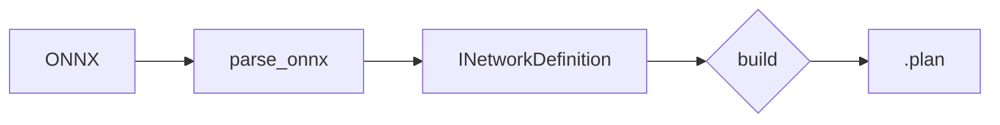

# ColorTextInMarkdown

+ A catalogue of Markdown / HTML rendering tricks: color, boxes, collapsible sections and diagrams.

+ There are two families of renderer, and the difference decides almost everything:

+ **Sanitizing renderers** (GitHub, GitLab, most forges and wikis) run the generated HTML through an
  allowlist. `style`, `class`, `id`, `<script>`, `<style>` and most attributes are **deleted**. The
  tag often survives while its appearance does not, so the text still shows up — unstyled, with no
  error anywhere. This is why a `<span style="color:red">` looks fine locally and is plain black on
  GitHub.
+ **Full-HTML renderers** (VS Code, Typora, `pandoc`, browsers, most static-site generators)
  pass HTML through untouched, so inline CSS works.

The practical consequence: **anything that depends on `style` is a local-only effect.** If the
document will be read on a forge, the color has to come from somewhere the sanitizer does not
touch — an image, a code block, or LaTeX.

Each heading below carries its own support, as `(GitHub …, VS Code …, Full HTML …)`:
+ 🟩: works
+ 🟥: silently does not work (the content usually still appears, just unstyled)
+ ➖: depends on the renderer / needs an extension

---

## 1. Color

### 1.1 Inline CSS (GitHub 🟥, VS Code 🟩, Full HTML 🟩)

<span style="color:rgb(255,100,120)">Coral pink text</span>,
<span style="background-color:rgb(90,200,250);color:#fff;padding:2px 6px;border-radius:3px">a sky-blue pill</span>.

```html
<span style="color:rgb(255,100,120)">Coral pink text</span>
<span style="background-color:rgb(90,200,250);color:#fff;padding:2px 6px;border-radius:3px">a pill</span>
```

### 1.2 LaTeX `\color` (GitHub 🟩, VS Code 🟩, Full HTML ➖)

This is the **only** way to get arbitrary colored text on GitHub without an image, because math is
rendered by KaTeX after sanitizing rather than being HTML at all.

$\color{red}\textsf{red text}$,
$\color{green}\textsf{green text}$,
$\color{blue}\textsf{blue text}$

```
$\color{red}\textsf{red text}$
$\color{red}\blacksquare$
$\fcolorbox{gray}{#00ffff}{\phantom{x}}$
```

Colored squares, useful as a legend or swatch:

$\color{red}\blacksquare$,
$\color{orange}\blacksquare$,
$\color{green}\blacksquare$,
$\color{blue}\blacksquare$,
$\color{purple}\blacksquare$

```
$\color{red}\blacksquare$,
$\color{orange}\blacksquare$,
$\color{green}\blacksquare$,
$\color{blue}\blacksquare$,
$\color{purple}\blacksquare$
```

$\fcolorbox{gray}{#ff0000}{\phantom{x}}$,
$\fcolorbox{gray}{#00ff00}{\phantom{x}}$,
$\fcolorbox{gray}{#0000ff}{\phantom{x}}$,
$\fcolorbox{gray}{#000000}{\phantom{x}}$,
$\fcolorbox{gray}{#ffffff}{\phantom{x}}$

```
$\fcolorbox{gray}{#ff0000}{\phantom{x}}$,
$\fcolorbox{gray}{#00ff00}{\phantom{x}}$,
$\fcolorbox{gray}{#0000ff}{\phantom{x}}$,
$\fcolorbox{gray}{#000000}{\phantom{x}}$,
$\fcolorbox{gray}{#ffffff}{\phantom{x}}$
```

### 1.3 `diff` code block — zero-dependency red / green (GitHub 🟩, VS Code 🟩, Full HTML ➖)

```diff
+ this line is green
- this line is red
! this line is orange (in some highlighters)
@@ this is highlighted @@
```

````
```diff
+ this line is green
- this line is red
! this line is orange (in some highlighters)
@@ this is highlighted @@
```
````

Works anywhere there is syntax highlighting at all, which makes it the most portable color trick.
The cost is that it only does a few colors and only whole lines.

### 1.4 `ansi` code block — full terminal color (GitHub 🟩, VS Code 🟥, Full HTML 🟥)

Paste real terminal output, escape codes and all, and GitHub renders the colors:

Write `\e` below as a **literal ESC byte (0x1B)** — it is invisible in an editor, so produce it with
something like `printf '\033[0;31mERROR\033[0m\n'` and paste the result, or just paste real
terminal output straight from your scrollback.

````markdown
```ansi
\e[0;31mERROR\e[0m  build failed
\e[0;32mPASS \e[0m  42 tests
\e[1;33mWARN \e[0m  deprecated API
```
````

Rendered (this block contains the real escape bytes):

```ansi
ERROR  build failed
PASS   42 tests
WARN   deprecated API
INFO   engine built in 12.4 s
```

This is the nicest way to show compiler or `trtexec` output as it actually looked. Note that the
escape bytes are invisible in `git diff` and in most editors, so a block like this is easy to break
accidentally — keep it short.

### 1.5 Badges — color as an image (GitHub 🟩, VS Code 🟩, Full HTML 🟩)

Pattern: `https://img.shields.io/badge/<label>-<message>-<color>`, with `_` for a space and `__`
for a literal underscore. Needs network access at render time, which is the one real drawback.
No sanitizer can touch it.since it is an ``.


```


```

### 1.6 Colored emoji (GitHub 🟩, VS Code 🟩, Full HTML 🟩)

🟥, 🟧, 🟨, 🟩, 🟦, 🟪, ⬛, ⬜, 🔴, 🟠, 🟡, 🟢, 🔵, 🟣, ⚫, ⚪

---

## 2. Callout / admonition boxes

### 2.1 GitHub alerts (GitHub 🟩, VS Code 🟩, Full HTML ➖)

Exactly those five keywords, uppercase, on the first line of a blockquote. This is the modern
replacement for a hand-rolled colored `<div>`, and it is theme-aware: it stays readable in both
light and dark mode, which a hard-coded background color does not.

> [!NOTE]
> Useful information that users should know, even when skimming content.

> [!TIP]
> Helpful advice for doing things better or more easily.

> [!IMPORTANT]
> Key information users need to know to achieve their goal.

> [!WARNING]
> Urgent info that needs immediate user attention to avoid problems.

> [!CAUTION]
> Advises about risks or negative outcomes of certain actions.

```
> [!NOTE]
> Useful information that users should know, even when skimming content.

> [!TIP]
> Helpful advice for doing things better or more easily.

> [!IMPORTANT]
> Key information users need to know to achieve their goal.

> [!WARNING]
> Urgent info that needs immediate user attention to avoid problems.

> [!CAUTION]
> Advises about risks or negative outcomes of certain actions.
```

### 2.2 Hand-rolled box — local only (GitHub 🟥, VS Code 🟩, Full HTML 🟩)

<div style="background-color:rgb(232,245,233);color:rgb(46,125,50);padding:1em;border-radius:6px">
A green box. Degrades to an unstyled paragraph where <code>style</code> is stripped.
</div>

```
<div style="background-color:rgb(232,245,233);color:rgb(46,125,50);padding:1em;border-radius:6px">
A green box. Degrades to an unstyled paragraph where <code>style</code> is stripped.
</div>
```

---

## 3. Collapsible sections (GitHub 🟩, VS Code 🟩, Full HTML 🟩)

`<details>` is native HTML, not CSS, so sanitizers keep it. It is the best tool for long logs,
optional derivations and FAQ lists.

<details>
<summary>Click to expand</summary>

```python
print("Code blocks work in here too")
```

<details open>
<summary>Inner section, open by default</summary>

Text in the inner block.

</details>

</details>

---

````html
<details>
<summary>Click to expand</summary>

```python
print("Code blocks work in here too")
```

<details open>
<summary>Inner section, open by default</summary>

Text in the inner block.

</details>

</details>
````

---

## 4. Layout and alignment

### 4.1 `align` attribute (GitHub 🟩, VS Code 🟩, Full HTML 🟩)

`align` is an old HTML attribute rather than CSS, so it survives sanitizing where `style` does not.

<div align="center">

**A centered block, including text, images and headings.**

</div>

```html
<div align="center">

**A centered block, including text, images and headings.**

</div>
```

### 4.3 Raw `<table>` for merged cells (GitHub 🟩, VS Code 🟩, Full HTML 🟩)

Pipe tables cannot merge cells; raw HTML can.

Markdown inside raw `<table>` cells is **not** processed on GitHub; use HTML (`<code>`, `<b>`) there.

<table>
<tr><th>Stage</th><th>Tool</th><th>Output</th></tr>
<tr><td rowspan="2">Build</td><td>trtexec</td><td rowspan="2">.plan</td></tr>
<tr><td>Python API</td></tr>
<tr><td>Run</td><td colspan="2">trtexec with plugins</td></tr>
</table>

```
<table>
<tr><th>Stage</th><th>Tool</th><th>Output</th></tr>
<tr><td rowspan="2">Build</td><td>trtexec</td><td rowspan="2">.plan</td></tr>
<tr><td>Python API</td></tr>
<tr><td>Run</td><td colspan="2">trtexec</td></tr>
</table>
```

---

## 5. Typographic inline tags

All of these are plain HTML tags on every sanitizer allowlist.

| Effect               | Source                            | Rendered                        |
| -------------------- | --------------------------------- | ------------------------------- |
| Key caps             | `<kbd>Ctrl</kbd>+<kbd>C</kbd>`    | <kbd>Ctrl</kbd>+<kbd>C</kbd>    |
| Subscript            | `H<sub>2</sub>O`                  | H<sub>2</sub>O                  |
| Superscript          | `x<sup>2</sup>`                   | x<sup>2</sup>                   |
| Strikethrough        | `~~deprecated~~`                  | ~~deprecated~~                  |
| Inserted             | `<ins>added</ins>`                | <ins>added</ins>                |
| Deleted              | `<del>removed</del>`              | <del>removed</del>              |
| Highlight            | `<mark>important</mark>`          | <mark>important</mark>          |
| Sample output        | `<samp>Segmentation fault</samp>` | <samp>Segmentation fault</samp> |
| Variable             | `<var>batch_size</var>`           | <var>batch_size</var>           |
| Small print          | `<small>caveat</small>`           | <small>caveat</small>           |
| Line break in a cell | `a<br>b`                          | a<br>b                          |

`<kbd>` is the only one of these that GitHub gives a real border and background to, so it stands out without any CSS.

---

## 6. Diagrams and math

### 6.1 Mermaid (GitHub 🟩, VS Code ➖, Full HTML ➖)

Also does `sequenceDiagram`, `flowchart`, `classDiagram`, `stateDiagram-v2`, `gantt`, `pie` and
`gitGraph`. The big advantage over a checked-in PNG is that it stays diffable and editable.
GitHub renders it natively; VS Code's preview needs an extension.



````

````

### 6.2 Math (GitHub 🟩, VS Code 🟩, Full HTML ➖)

Inline with single `$`, and display mode with `$$`:

$y = \sigma(Wx + b)$

```
$y = \sigma(Wx + b)$
```

$$
\mathrm{Attention}(Q,K,V) = \mathrm{softmax}\!\left(\frac{QK^{\top}}{\sqrt{d_k}}\right)V
$$

```
$$
\mathrm{Attention}(Q,K,V) = \mathrm{softmax}\!\left(\frac{QK^{\top}}{\sqrt{d_k}}\right)V
$$
```

### 6.3 ASCII / box-drawing diagrams (GitHub 🟩, VS Code 🟩, Full HTML 🟩)

Inside a code block, box-drawing characters give a diagram that needs no renderer at all — it
survives `cat`, `git diff`, terminal pagers and e-mail.

```txt
   input (1,3,224,224)
          │
   ┌──────▼──────┐
   │ Convolution │
   └──────┬──────┘
          │
   ┌──────▼──────┐
   │  Activation │
   └──────┬──────┘
          ▼
   output (1,64,112,112)
```

---

## 7. Images

### 7.1 Sizing without CSS

`` is an allowlisted attribute, so it works where `style="zoom:70%"` does not.

```html

```

Note that several READMEs in this cookbook use `style="zoom:70%;"`, which is a **local-only** effect;
`width=` is the portable equivalent.

### 7.2 Light / dark adaptive images (GitHub 🟩, VS Code 🟩, Full HTML 🟩)

```html
<picture>
  <source media="(prefers-color-scheme: dark)"  srcset="./diagram-dark.png">
  <source media="(prefers-color-scheme: light)" srcset="./diagram-light.png">
  
</picture>
```

The fix for a diagram with a white background that becomes unreadable in dark mode.

### 7.3 Clickable image

```markdown
[](./full-size.png)
```

---

## 8. Lists, links and structure

### 8.1 Task lists

On GitHub these are clickable in issues and PRs, and contribute to progress counters.

+ [x] done
+ [ ] not done

```markdown
+ [x] done
+ [ ] not done
```

### 8.2 Footnotes (GitHub 🟩, VS Code 🟩, Full HTML ➖)

A claim that needs a source[^trt] and another one[^note].

[^trt]: Footnote text, collected at the bottom of the document automatically.
[^note]: Order of definition does not matter; order of first reference does.

```markdown
A claim that needs a source[^tag].

[^tag]: The footnote text.
```

### 8.3 Definition-style lists

Not standard Markdown, but a two-column table reads the same and works everywhere:

| Term    | Definition                                          |
| ------- | --------------------------------------------------- |
| Engine  | A serialised, hardware-specific execution plan.     |
| Profile | A set of min / opt / max shapes for dynamic inputs. |

### 8.4 Heading anchors

Every heading gets an automatic anchor: lowercase, spaces to `-`, punctuation dropped. So
`## Color` is reachable as [`#1-color`](#1-color).

```markdown
[jump](#1-color)
```

---

## 9. Code blocks

### 9.1 Nested fences

Use more backticks on the outside than anything on the inside:

`````markdown
````markdown
```python
print("a fenced block inside a fenced block")
```
````
`````

### 9.2 Useful language tags

| Tag                         | Use                                                       |
| --------------------------- | --------------------------------------------------------- |
| `diff`                      | red / green lines (see 1.3)                               |
| `ansi`                      | terminal color (see 1.4)                                  |
| `console` / `shell-session` | highlights the `$` prompt differently from the output     |
| `txt` / `text`              | explicitly *no* highlighting, for ASCII diagrams and logs |
| `mermaid`                   | diagram (see 6.1)                                         |

```console
$ python3 main.py
Succeeded building engine!
```

### 9.3 Keeping a long line from wrapping

A code block never wraps or reflows, which makes it the right container for a long command line or a
path that must be copied exactly.

---

## 10. Invisible and miscellaneous

### 10.1 Comments

```markdown
<!-- This is invisible in every renderer. -->
```

<!-- Such as this one, which you cannot see. -->

Useful for `<!-- markdownlint-disable -->`, for editor notes, and for marking generated regions.

### 10.2 Horizontal rule

Three or more `---` on their own line, with a blank line before it so it is not parsed as a Setext
heading underline for the preceding paragraph.

### 10.3 Hard line break

Two trailing spaces, or a trailing backslash, or `<br>`. The backslash is better than two spaces
because trailing whitespace is invisible and many editors strip it on save.

```markdown
first line\
second line
```

first line\
second line

### 10.4 Escaping

Backslash-escape any Markdown punctuation to show it literally: `\*not italic\*` gives \*not italic\*.
